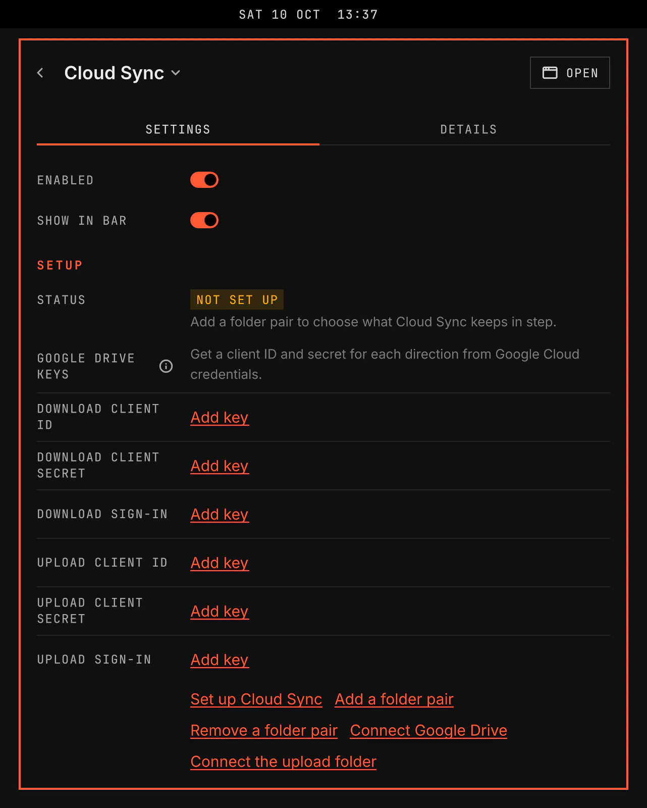

# Cloud Sync

Cloud Sync keeps Google Drive folders on this computer and sends one folder of this computer to Google Drive. It runs every hour while you are logged in, also while VGS is closed, and never deletes a file.

Screenshot made with `scripts/readme-shots.sh` in the nested sandbox, with the default theme at scale 2.

## Features

- Folder pairs: each pair joins one Google Drive folder and one folder on this computer. A Download pair copies the Drive folder to this computer. An Upload pair copies the folder on this computer to Drive.
- Every hour while you are logged in, and when you select Sync now. An hour missed while you were logged out syncs once at the next login. One sync of a pair runs at a time, whoever starts it.
- Google Docs, Sheets, Slides and Drawings arrive as Word, Excel, PowerPoint and SVG files. A file that Cloud Sync sends to Drive stays a file.
- Nothing is deleted. A file you changed on this computer since the last download is kept in Cloud Sync's records, and the Drive version takes its place. A file that Drive removed stays on this computer. The window lists each one under To review, below its folder pair, with Open folders, which opens the folders that hold its versions.
- Editor temporary files, unfinished downloads, Git and agent folders, `local/`, keys and credential files and old backups are never copied.
- Once a folder pair exists, a bar icon shows the state: up to date, files to review, syncing, paused, offline, sign-in needed or failed, with the count of files to review. The bar, the window and the Settings page show the same state. The tooltip names each folder pair and its state. It never shows a file name or an account.
- A window with the state, the last complete sync, the last problem, the folder pairs with Remove, and the files to review, with Sync now, Pause and Resume.
- A notification when Cloud Sync needs you: a sign-in, a failed sync or files to review.
- Pause stays on after VGS or the computer restarts. Disabling the plugin does not stop the hourly sync.
- When Google Drive cannot be reached, the files stay as the last complete sync left them, and the window shows the time of that sync.

## Setup

Open the Cloud Sync page in Settings. The Setup section and the Download and Upload groups hold every step.

1. Under Hourly sync, select Set up hourly sync. A setup window starts the hourly sync. Cloud Sync runs every hour while you are logged in.
2. Get the Google Drive keys from [Google Cloud credentials](https://console.cloud.google.com/apis/credentials). Create an OAuth client ID of type Desktop app for Download, and a second one for Upload. Download only reads your Drive. The Upload client reaches only the files and folders that Cloud Sync made.
3. In the Download group, select Add key beside Client ID and Client secret, and paste each into the masked field. Do the same in the Upload group when you use an Upload folder pair. VGS stores every key in your keyring.
4. Under Sign-in in each group, select Sign in. Google opens in your browser. Sign in and allow access. VGS stores the sign-in in your keyring, and the Sign-in line shows the Google account.
5. Under Folder pairs, select Add a folder pair. A setup window asks for a name, the direction, the Google Drive folder and the folder on this computer. A folder pair cannot be your home folder, a folder that holds a Git repository, a folder of VGS or your system services, or the whole Drive, and two pairs cannot overlap.

Remove a folder pair, on the Settings page or beside the pair in the Cloud Sync window, stops the sync of a pair. Its files stay on this computer and on Drive.

If the folder pair list cannot be read, select Start the folder pair list again. VGS keeps the damaged list beside a new empty list.

When a Sign-in line reads Sign-in refused, select Sign in again in that group. Sign out removes the sign-in from your keyring and deletes no file.

[developer.md](developer.md) states how a sync works, the files and the runner's commands.
